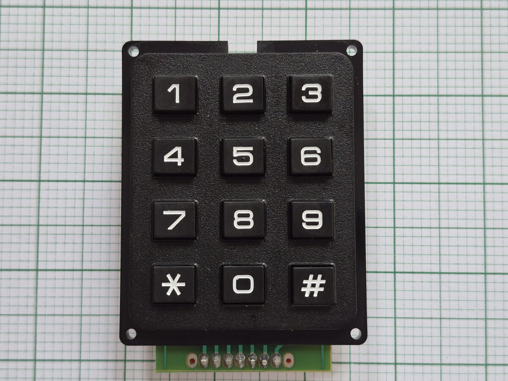

# Random Thoughts



## Why this component

SparkFun has a few boards that use an ATtiny84 IC as their I2C interface.
Unfortunately, ESPHome does not support this SparkFun board.
That is why I created this repo: to give myself, and others, a way to use the `SparkFun Qwiic Keypad - 12 Button` board with ESPHome.

## Example usage

Below is an example YAML configuration that uses the keypad to energise a relay via an MCP23017 I/O expander.

```yaml
esphome:
  name: qwiic-keypad-esp-idf

esp32:
  board: esp32dev
  framework:
    type: esp-idf

external_components:
  source:
    type: git
    url: https://github.com/ThatOneNeji/esphome_qwiic_keypad
    ref: main

wifi:
  ssid: !secret wifi_ssid
  password: !secret wifi_password

# Enable the web server so that you can view the logs in a browser
web_server:
  port: 80
  version: 3
  include_internal: false

logger:

i2c:
  - id: i2c_bus
    sda: GPIO21
    scl: GPIO22
    frequency: 400kHz
    scan: true

api:
  reboot_timeout: 0s

# We use the MCP23017 to control I/O: in this case, the relay board
mcp23017:
  - id: mcp23017_hub
    i2c_id: i2c_bus
    address: 0x27

# Set up the SparkFun keypad
qwiic_keypad:
  id: keypad
  i2c_id: i2c_bus
  address: 0x4B
  on_key:
    - logger.log:
        format: "on_key: %c"
        args: ["x"]

# Next, we use the `key_collector` component to collect the keypad's button presses.
# When `1234#` is entered, we run the script `pulse_internal_switch`, which in turn switches the relay on for 5 seconds.
# `*` deletes the last digit.
# We use `1234` as the code here; for real use, move it to `secrets.yaml`.
key_collector:
  - id: pincode
    source_id: keypad
    min_length: 4
    max_length: 4
    end_keys: "#"
    end_key_required: true
    back_keys: "*"
    allowed_keys: "0123456789*#"
    timeout: 5s
    on_progress:
      - logger.log:
          format: "input progress: '%s'"
          args: ["x.c_str()"]
    on_result:
      - logger.log:
          format: "input result: '%s'"
          args: ["x.c_str()"]
      - if:
          condition:
            lambda: 'return x == "1234";'
          then:
            - logger.log: "PIN correct"
            - script.execute: pulse_internal_switch
          else:
            - logger.log: "PIN wrong"
    on_timeout:
      - logger.log: "input timed out"

script:
  # Turns internal_switch on for 5 seconds. mode: restart means a second correct PIN during those 5 seconds starts
  # the 5 seconds over, instead of being ignored with an "already running" warning.
  - id: pulse_internal_switch
    mode: restart
    then:
      - switch.turn_on: internal_switch
      - delay: 5s
      - switch.turn_off: internal_switch

switch:
  # From our experience, to avoid confusing the relay, we have all other components toggle this switch instead of
  # the relay itself
  - platform: template
    name: "Internal Control for 'Relay 2'"
    id: internal_switch
    restore_mode: ALWAYS_OFF
    optimistic: true
    on_state:
      - then:
          - switch.control:
              id: MCP23017_Pin_A1
              state: !lambda "return id(internal_switch).state;"
    icon: "mdi:power-plug"

  # Set up the relay here, but control it through the state of `internal_switch`
  - platform: gpio
    name: "Relay 2"
    restore_mode: ALWAYS_OFF
    icon: "mdi:power-plug"
    pin:
      mcp23xxx: mcp23017_hub
      number: 1
      mode:
        output: true
      inverted: true
    id: MCP23017_Pin_A1
    device_class: outlet
```
