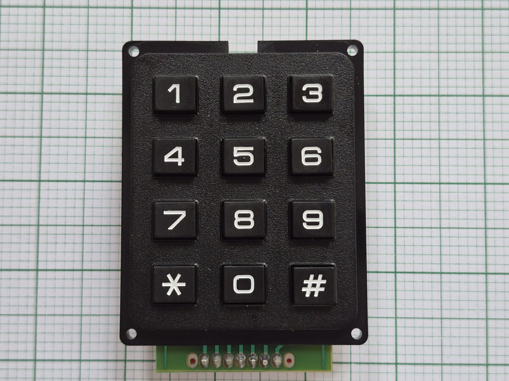
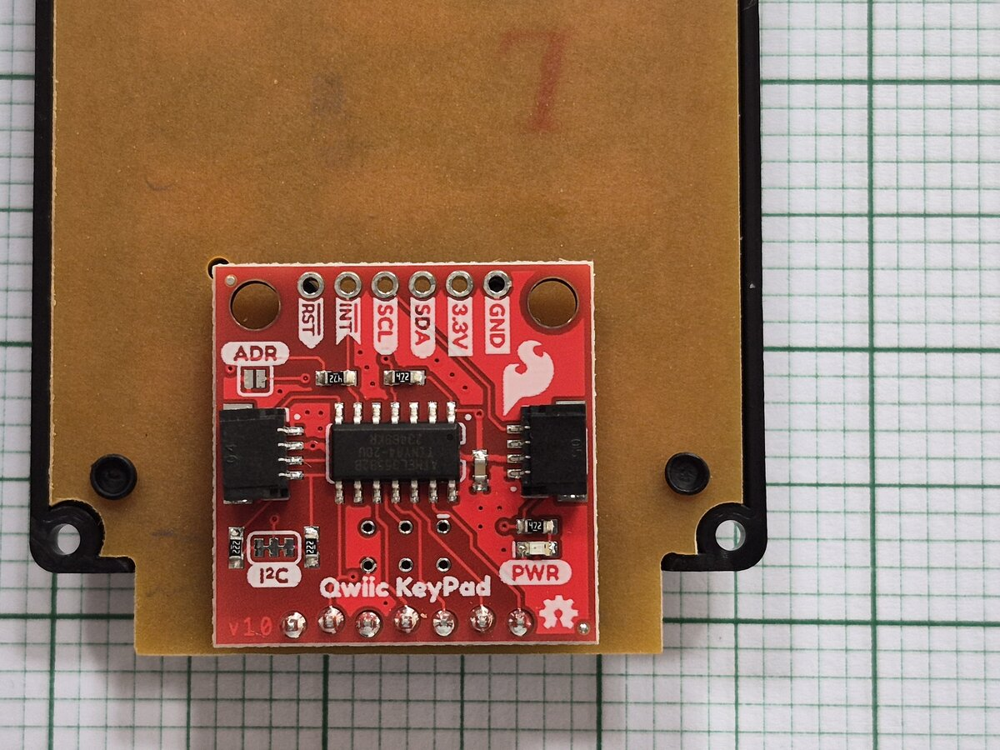

# qwiic_keypad

ESPHome component for the [SparkFun Qwiic Keypad - 12 Button](https://www.sparkfun.com/sparkfun-qwiic-keypad-12-button.html).

It works like ESPHome's own [`matrix_keypad`](https://esphome.io/components/matrix_keypad/): the same `on_key`
trigger, the same per-key `binary_sensor`s, and the same [`key_collector`](https://esphome.io/components/key_collector/)
support. The difference is that the keypad is read over I2C, so it needs no GPIO pins for the rows and columns.

- [Hardware](#hardware)
- [Hub configuration (`qwiic_keypad:`)](#hub-configuration-qwiic_keypad)
- [Single keys (`binary_sensor:`)](#single-keys-binary_sensor)
- [Entering codes (`key_collector:`)](#entering-codes-key_collector)
- [Differences from `matrix_keypad`](#differences-from-matrix_keypad)
- [Known limitations](#known-limitations)
- [Full example](#full-example)
- [Troubleshooting](#troubleshooting)

## Hardware

A 12-button keypad (`1`–`9`, `*`, `0`, `#`) with a small board on the back. An ATtiny84 on that board scans the
keys, debounces them, and keeps recent key presses in a small queue (about 14) that this component reads over I2C. It connects
over the [Qwiic connector system](https://www.sparkfun.com/qwiic) (JST SH 4-pin: 3.3V, GND, SDA, SCL).





|                           |                                                                                                           |
|---------------------------|-----------------------------------------------------------------------------------------------------------|
| Default I2C address       | `0x4B` (`0x4A` with the ADR jumper closed)                                                                |
| Expected chip/device ID   | `0x4B` (read from register `0x00`; the component checks this at boot and fails setup if it doesn't match) |
| Logic level               | 3.3V (do not power from 5V)                                                                               |
| I2C pull-ups              | 2.2 kΩ on the board, enabled by the I2C jumper (closed by default)                                        |
| Firmware source           | <https://github.com/sparkfun/Qwiic_Keypad>                                                                |
| Reference Arduino library | <https://github.com/sparkfun/SparkFun_Qwiic_Keypad_Arduino_Library>                                       |
| Hookup guide              | <https://learn.sparkfun.com/tutorials/qwiic-keypad-hookup-guide>                                          |

The keypad reports **presses only**. It never says when a key is released, and holding a key down reports a single
press with no auto-repeat. See [Known limitations](#known-limitations) for what that means for binary sensors.

The address can also be changed through the device's own address register, which stores it in the keypad's
EEPROM. This component never writes that register: set `address:` to whatever the board is already using.

Wiring straight to an ESP32:

| Qwiic pin | ESP32                    |
|-----------|--------------------------|
| 3.3V      | 3.3V                     |
| GND       | GND                      |
| SDA       | any GPIO (e.g. `GPIO21`) |
| SCL       | any GPIO (e.g. `GPIO22`) |

**This component only uses the Qwiic connector (I2C).** The board also has an `INT` pin, which goes low while key
presses are queued, but it is only on the pin header, not on the Qwiic connector. To keep the keypad plug-and-play
with a single Qwiic cable, this component doesn't support `INT`: it polls the queue over I2C instead. The `RST` pin
on the header isn't used either.

The component has been tested on an ESP32 (ESP-IDF) with the I2C bus at 800 kHz, sharing the bus with two other
devices.

## Hub configuration (`qwiic_keypad:`)

The `qwiic_keypad:` component owns the connection to the board. The `binary_sensor:` platform and `key_collector:`
attach to it by ID; you need one `qwiic_keypad:` entry per physical keypad.

```yaml
i2c:
  sda: GPIO21
  scl: GPIO22

qwiic_keypad:
  id: keypad
  address: 0x4B         # optional, this is the factory default
  keys: "123456789*0#"  # optional, one key code per button, this is the default
  release_delay: 200ms  # optional, see below
  on_key:
    - logger.log:
        format: "Key %c pressed"
        args: ["x"]
```

| Option          | Default        | Description                                                                                                                                                                                                                                    |
|-----------------|----------------|------------------------------------------------------------------------------------------------------------------------------------------------------------------------------------------------------------------------------------------------|
| `id`            | -              | ID to reference this keypad from `binary_sensor:` and `key_collector:` entries.                                                                                                                                                                |
| `i2c_id`        | -              | ID of the `i2c:` bus to use, if you have more than one.                                                                                                                                                                                        |
| `address`       | `0x4B`         | I2C address of the board.                                                                                                                                                                                                                      |
| `keys`          | `123456789*0#` | The key code sent for each button, in the order `1 2 3 4 5 6 7 8 9 * 0 #` (row by row, as printed on the keypad). Must be exactly 12 ASCII characters. Use it to remap keys, for example `"123456789C0E"` to send `C` for `*` and `E` for `#`. |
| `release_delay` | `200ms`        | How long after a press the key counts as released (see [Known limitations](#known-limitations)). If you use the `binary_sensor`s in Home Assistant, keep this above the API's `batch_delay` (100 ms by default).                               |
| `on_key`        | -              | Automation run on every key press. The key code is available as `x` (a `uint8_t`; use `%c` to print it).                                                                                                                                       |

## Single keys (`binary_sensor:`)

Each `binary_sensor` follows one key. Choose the key either by its key code (`key:`) or by its position (`row:` and
`col:`), exactly as with `matrix_keypad`:

```yaml
binary_sensor:
  - platform: qwiic_keypad
    qwiic_keypad_id: keypad
    name: "Keypad 5"
    key: "5"
  - platform: qwiic_keypad
    qwiic_keypad_id: keypad
    name: "Keypad #"
    row: 3
    col: 2
```

| Option            | Description                                                                                   |
|-------------------|-----------------------------------------------------------------------------------------------|
| `qwiic_keypad_id` | ID of the `qwiic_keypad:` hub.                                                                |
| `key`             | The key code to follow (one character). If you set `keys:` on the hub, use the remapped code. |
| `row`, `col`      | The key's position instead of its code, counted from 0. Cannot be combined with `key:`.       |

Positions on the keypad:

|           | col 0 | col 1 | col 2 |
|-----------|-------|-------|-------|
| **row 0** | `1`   | `2`   | `3`   |
| **row 1** | `4`   | `5`   | `6`   |
| **row 2** | `7`   | `8`   | `9`   |
| **row 3** | `*`   | `0`   | `#`   |

A sensor turns ON when its key is pressed and OFF `release_delay` later, or straight away when another key is
pressed (only one key is active at a time, as with `matrix_keypad`). Pressing the same key again before the delay
ends turns the sensor OFF and back ON, so `on_press` runs for every press. All the standard `binary_sensor` options
(`on_press`, `on_release`, `filters`, …) are available.

## Entering codes (`key_collector:`)

The keypad can be used as a `source_id` for ESPHome's [`key_collector`](https://esphome.io/components/key_collector/),
for example for a 4-digit PIN entered with `#` and corrected with `*`:

```yaml
key_collector:
  - id: pincode
    source_id: keypad
    min_length: 4
    max_length: 4
    end_keys: "#"
    end_key_required: true
    back_keys: "*"
    allowed_keys: "0123456789*#"
    timeout: 5s
    on_progress:
      - logger.log:
          format: "input progress: '%s'"
          args: ["x.c_str()"]
    on_result:
      - logger.log:
          format: "input result: '%s'"
          args: ["x.c_str()"]
    on_timeout:
      - logger.log: "input timed out"
```

`key_collector` ignores an end key when the code is shorter than `min_length`, and ignores extra keys once
`max_length` is reached. That's `key_collector`'s own behaviour, not a missed key press.

## Differences from `matrix_keypad`

| `matrix_keypad`                                       | `qwiic_keypad`                                                                          |
|-------------------------------------------------------|-----------------------------------------------------------------------------------------|
| `rows`, `columns`, `has_diodes`, `has_pulldowns`      | Not needed: the keypad's own chip scans the keys.                                       |
| `debounce_time`                                       | Not available: the keypad debounces the keys itself.                                    |
| `keys` is optional; without it, no key codes are sent | `keys` defaults to the printed labels, so key codes are always sent.                    |
| A key is released when you let go of it               | A key is released `release_delay` after the press (the keypad never reports a release). |
| `row` and `col` aren't range-checked                  | `row` (0–3) and `col` (0–2) are checked against the keypad's fixed layout.              |

## Known limitations

These come from the keypad's hardware and firmware, so they can't be fixed in this component.

- **Releases are generated, not measured.** The keypad never reports a release, so a key is released
  `release_delay` after its press. Holding a key down does not keep its `binary_sensor` ON.
- **Overlapping key presses are lost.** If you press a key while the previous key is still down, or within about
  20 ms of releasing it, the keypad doesn't record the second key. The firmware's
  [`Keypad` library](https://github.com/Chris--A/Keypad) only reports the first key in its list. One key at a time
  works reliably; very fast typing can drop keys.
- **Stiff new keys can register one press as two.** The keypad only filters out bounces shorter than 10 ms. Some
  keys on a new keypad bounce for longer (we measured 86–112 ms), so a single press can arrive as two presses. With
  `key_collector`, a single `*` press may then delete two characters.
- **Home Assistant can merge very quick repeat presses.** The ESPHome API sends state updates in batches (every
  `batch_delay`, 100 ms by default) and only sends each entity's latest state. If the same key is pressed twice
  within `release_delay`, Home Assistant may see a single press. On-device automations (`on_key`, `on_press`,
  `key_collector`) still see both presses.

## Full example

See [`example.yaml`](../../example.yaml) (Arduino framework) and [`example.esp-idf.yaml`](../../example.esp-idf.yaml)
(ESP-IDF framework) in the repository root for complete, buildable configs.

## Troubleshooting

**`Unknown chip ID 0x..` at boot.** Something else is answering at that address. Check the I2C scan in the boot log
(`i2c: scan: true`) and set `address:` to the keypad's address (`0x4B`, or `0x4A` with the ADR jumper closed).

**`Communication failed` warnings.** Check the Qwiic cable and wiring first. If you have several I2C boards with
their own pull-ups on the same bus, try lowering the bus `frequency:`, or open the I2C jumper on one of the boards.

**A binary sensor never shows ON in Home Assistant, only OFF.** `release_delay` is too short for the API's batching.
Keep it above the `api:` `batch_delay` (100 ms by default). The default of 200 ms handles this.

**A single press registers twice.** That's a key bouncing (see [Known limitations](#known-limitations)). It is most
common on new keypads.

**Some key presses are missing.** Press one key at a time and let go of each key before pressing the next (see
[Known limitations](#known-limitations)).

**Key presses made while the ESP was starting up don't appear.** That's on purpose. Presses queued before boot are
discarded during setup, so they aren't replayed as if they had just happened.
